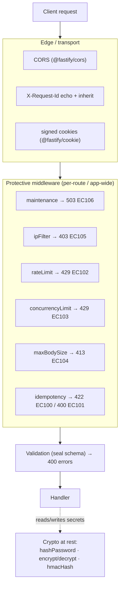

Lock down an app in an afternoon: keep secrets out of source, put the protective middleware on the routes that need it, turn on the transport hardening, and validate every input. The [hardening checklist](#hardening-checklist) at the end lists each step with the setting it uses.

Warlock has no single "security module". The pieces are crypto helpers for secrets, protective HTTP middleware, a few knobs in `src/config/http.ts`, and validation as a hard request boundary. Each section below names the page that goes deep on its piece, and every knob listed here is one the code reads today.

## The 30-second look



The layers, outside-in:

1. **Transport** — CORS, request-id correlation, cookie signing. Configured in `src/config/http.ts`.
2. **Protective middleware** — opt-in per route (or app-wide) gates that reject before your handler runs. Each emits a stable `HttpErrorCodes` value.
3. **Validation** — the seal schema attached to a controller runs before the handler. A failed schema is a rejected request, full stop.
4. **Crypto at rest** — when the handler stores a password or a secret, it reaches for the encryption helpers.

## Secrets and crypto

Two rules carry most of the weight: **never commit a secret, and pick the right crypto helper for the job.**

### Secrets live in `.env`, read through `env()`

Every key, password, and credential comes from the environment, surfaced through `env()` and wired into a config file — never inlined in source.

```ts title="src/config/encryption.ts"
import type { EncryptionConfigurations } from "@warlock.js/core";
import { env } from "@warlock.js/core";

const encryptionConfig: EncryptionConfigurations = {
  key: env("APP_ENCRYPTION_KEY"), // 64 hex chars = 32 bytes
  hmacKey: env("APP_HMAC_KEY"), // falls back to `key` if absent
  password: {
    salt: 12, // bcrypt rounds
  },
};

export default encryptionConfig;
```

### The three crypto helpers

All three live in `@warlock.js/core`. Mixing them up is the single most common security mistake — encrypting a password turns a database leak into a credentials leak; HMAC-ing one makes it brute-forceable.

| Helper                            | Direction  | Algorithm     | Use for                                                  |
| --------------------------------- | ---------- | ------------- | -------------------------------------------------------- |
| `hashPassword` / `verifyPassword` | one-way    | bcrypt (slow) | User-typed passwords. **Only** passwords.                |
| `encrypt` / `decrypt`             | reversible | AES-256-GCM   | Secrets you must read back — API keys, OAuth tokens.     |
| `hmacHash`                        | one-way    | HMAC-SHA256   | Deterministic fingerprints for lookup of encrypted data. |

```ts
import { hashPassword, verifyPassword, encrypt, decrypt, hmacHash } from "@warlock.js/core";

const hashed = await hashPassword("user-password-123"); // store this
const valid = await verifyPassword("user-password-123", hashed);

const cipher = encrypt("sk-proj-12345"); // iv:ciphertext:authTag
const plain = decrypt(cipher);

const fingerprint = hmacHash("sk-proj-12345"); // 64-char hex, deterministic
```

Full treatment — config shape, the encrypt-plus-fingerprint pattern, key rotation as a migration, why `bcryptjs` over native bcrypt — lives on the [Encryption](./encryption.md) page.

## Protective middleware

Warlock ships six built-in middleware factories under the `middleware` namespace. They are **opt-in** — registered per-route (in a route's `middleware` array) or app-wide (via `http.middleware.all`). None of them run unless you wire them in.

```ts
import { middleware, router } from "@warlock.js/core";

router.post("/auth/login", loginController, {
  middleware: [middleware.rateLimit({ max: 5, duration: 60_000 })],
});
```

Each rejection carries a stable `HttpErrorCodes` value so clients can branch on a code instead of parsing message text. The core range is `EC100..EC199` (`EC001..EC099` belongs to `@warlock.js/auth`).

| Factory                          | Rejects with           | Error code        | Caps / guards                                                           |
| -------------------------------- | ---------------------- | ----------------- | ----------------------------------------------------------------------- |
| `middleware.maintenance(…)`      | 503 + `Retry-After`    | `EC106`           | App in maintenance mode; allowlist bypass (default `["/health"]`).      |
| `middleware.ipFilter(…)`         | 403                    | `EC105`           | Allow / deny by IP or IPv4 CIDR. Fail-closed; `deny` wins over `allow`. |
| `middleware.rateLimit(…)`        | 429 + `Retry-After`    | `EC102`           | Requests-per-window per group key (default: client IP).                 |
| `middleware.concurrencyLimit(…)` | 429 + `Retry-After: 1` | `EC103`           | In-flight request cap per group key (default: route path).              |
| `middleware.maxBodySize(…)`      | 413                    | `EC104`           | Rejects when `Content-Length` exceeds the per-route cap.                |
| `middleware.idempotency(…)`      | 422 / 400              | `EC100` / `EC101` | Dedupes writes by `Idempotency-Key`; conflict vs. malformed key.        |

A few facts worth internalizing before you lean on these:

- **`rateLimit` and `concurrencyLimit` counters are process-local.** With `N` replicas the effective cap is `N × max`. For a genuinely shared rate limit, configure `@fastify/rate-limit`'s Redis store via `http.rateLimit` instead; for shared concurrency, reach for a `@warlock.js/cache` lock.
- **`ipFilter` reads the IP via `request.detectIp()`.** **Since 4.13.0 `http.trustProxy` defaults to `false`**, so that is the socket address and `X-Real-IP` / `X-Forwarded-For` are ignored. Earlier versions defaulted to `true` — client-settable headers were believed, which made per-IP rate limits and IP allow-lists bypassable. **Turn it on only behind a proxy you control that overwrites those headers**, and prefer the narrowest shape your topology allows over bare `true` — see [`trustProxy` shapes](#trustproxy-shapes) below.
- **`maxBodySize` is a per-route layer, not pre-read protection.** It short-circuits the application stack on `Content-Length`, but the server still reads the body off the wire. For true pre-read protection, lower `http.bodyLimit` at the Fastify level too.
- **`idempotency` must run after `authMiddleware`** — its cache key is scoped per-user so user A can't replay user B's key. Anonymous requests fall back to IP scope.
- **`maintenance` is toggled by config and needs a restart** to flip — there's no runtime hot-flip. Its allowlist defaults to `["/health"]` so health checks survive planned downtime.

The full error-code catalog and how rejections are shaped lives on the [Error handling](./error-handling.md) page.

### The global rate limit is separate

`@fastify/rate-limit` is always registered with a global cap read from `http.rateLimit` (`max` default `60`, `duration` default `60_000`ms). That global 429 is distinct from the per-route `middleware.rateLimit()` (`EC102`) — both can run, and either can reject. Use the global as a coarse backstop and the middleware for endpoints that need a tighter cap (login, OTP, password reset, AI completions). The global cap counts pages and API routes; static files and the health probes are exempt by default (`http.rateLimit.staticFiles: true` and `http.health.rateLimit: true` count them), see [Rate limiting → Static files](../recipes/rate-limiting.md#static-files).

## Transport concerns

Three transport-layer knobs live in `src/config/http.ts`. All are optional, with defaults you should review before production.

```ts title="src/config/http.ts"
import { env } from "@warlock.js/core";

export default {
  cors: {
    origin: env("APP_URL"),
    credentials: true,
  },
  cookies: {
    secret: env("COOKIE_SECRET"), // enables signed cookies
  },
  requestId: {
    header: "X-Request-Id", // default
    enabled: true, // default
  },
};
```

### CORS

CORS comes from `@fastify/cors`, configured via `http.cors` (a `FastifyCorsOptions`).

> ⚠ **Fixed in 4.13.0 — and breaking if you were relying on the old behaviour.** Up to and including 4.12.0 the framework's defaults (`{ origin: "*", methods: "*" }`) were spread **after** your configuration, so `http.cors` **had no effect on `origin` / `methods` in any release** — an app that carefully configured an allow-list still answered every origin. Your configuration now wins. **If your app has been running open CORS without knowing it, upgrading will start rejecting origins you never allow-listed.**

### Cookies

`@fastify/cookie` is always registered, and `http.cookies.options` becomes the cookie `parseOptions`. A cookie is whatever the client sends: `request.cookie(name)` returns it unverified, so a client can edit it freely.

For a value the client must not change, set `http.cookies.secret` **and** write and read the cookie as signed. The secret alone signs nothing:

```ts
response.cookie("cartOwner", ownerId, { signed: true }); // signed with http.cookies.secret

const ownerId = request.signedCookie("cartOwner"); // undefined when missing or changed
```

`request.signedCookie(name, defaultValue?)` verifies the signature and returns `defaultValue` (or `undefined`) for a missing, unsigned or edited cookie. Both `signed: true` and `signedCookie()` throw an error naming `http.cookies.secret` when no secret is set.

`request.cookie()` parses a value that is valid JSON, so the client picks its type (`{"a":1}` comes back as an object). Pass `{ json: false }` to get the raw string, or set `http.cookies.json: false` to make that the default (string values are then also written without JSON quoting):

```ts
const theme = request.cookie("theme", "light", { json: false }); // always a string
```

### Request-id correlation

Every request gets a `request.id`. The framework echoes it back as a response header (`X-Request-Id` by default) and **inherits** an incoming value of the same header when present, so a single id correlates client logs, server logs, and traces.

Inherited values are validated before use — non-empty printable ASCII, max 128 characters — to block log-injection from a malicious client (a forged newline in a header could otherwise corrupt your log stream). Knobs under `http.requestId`:

| Key         | Default          | Effect                          |
| ----------- | ---------------- | ------------------------------- |
| `header`    | `"X-Request-Id"` | Inbound + outbound header name. |
| `generator` | random 32-char   | Override the id generator.      |

An inherited id is used only while no other request with the same id is being answered: `request.id` keys the request's log records, so a client repeating the id of a request in flight gets a fresh id instead of merging its records into that one.
| `enabled` | `true` | Set `false` to stop echoing and inheriting. `request.id` is still generated for internal logging. |

### Content-Security-Policy — new in 5.12

`http.csp` is an opt-in `Content-Security-Policy` header, disabled by default — an app that never sets it (or sets `enabled: false`) sees no behavior change:

```ts title="src/config/http.ts"
export default {
  csp: {
    enabled: true,
    // reportOnly: true, // emit Content-Security-Policy-Report-Only instead — observe before enforcing
    directives: {
      "img-src": ["'self'", "data:", "https://cdn.example.com"],
    },
  },
};
```

The framework starts from a conservative default policy and lets an app override it one directive at a time — a directive named in `directives` **replaces** the framework default for that directive entirely (never merged element-wise), so declare the full list of values you want:

```ts
{
  "default-src": ["'self'"],
  "script-src": ["'self'"],
  "style-src": ["'self'"],
  "img-src": ["'self'", "data:"],
  "object-src": ["'none'"],
  "base-uri": ["'self'"],
  "frame-ancestors": ["'self'"],
}
```

`script-src` is special-cased regardless of whether it's declared: the **current request's CSP nonce** — the same per-request nonce the framework already generates and that `request.nonce` exposes to the web layer's `<script>` tags — is always appended to it (`'nonce-<value>'`), so the framework's own inline/module scripts keep working even under a strict policy.

Malformed directive values fail the boot, not a random request: a value containing `;` (would truncate the directive) or with an odd number of `'` characters (a truncated/malformed keyword like `'self`) throws `InvalidCspDirectiveError` when the server starts, naming the offending directive and value.

### Security response headers — new in 5.42

`http.securityHeaders` stamps browser-hardening headers on **every** response, and it is **on by default**: routed handlers, static files, 404s, and early refusals (CORS, 413 body limit, 429 rate limit, 405, malformed URLs, the page host's refusals), including handlers that call `reply.raw.writeHead()`. The headers are set in the server's first `onRequest` hook, on the Node response, so nothing later can miss them. It works the same in production, `warlock dev` and `createTestHttpServer`.

| Header                                                         | Default                                                                                                                    | Config key                                                                            |
| -------------------------------------------------------------- | -------------------------------------------------------------------------------------------------------------------------- | ------------------------------------------------------------------------------------- |
| `Content-Security-Policy: frame-ancestors` + `X-Frame-Options` | `frame-ancestors 'none'` + `DENY`                                                                                          | `frameAncestors`: `"none"`, `"self"` (`SAMEORIGIN`), or a list (no `X-Frame-Options`) |
| `X-Content-Type-Options`                                       | `nosniff`                                                                                                                  | `contentTypeOptions`                                                                  |
| `Referrer-Policy`                                              | `strict-origin-when-cross-origin`                                                                                          | `referrerPolicy`                                                                      |
| `Permissions-Policy`                                           | camera, microphone, geolocation for your own pages only (`(self)`); accelerometer, gyroscope, magnetometer, usb off (`()`) | `permissionsPolicy`                                                                   |
| `Strict-Transport-Security`                                    | production only: `max-age=31536000; includeSubDomains`                                                                     | `hsts`: `{ maxAge, includeSubDomains, preload, onlyInProduction }`                    |

```ts title="src/config/http.ts"
export default {
  securityHeaders: {
    frameAncestors: ["'self'", "https://portal.example.com"],
    permissionsPolicy: { camera: [] }, // merged over the defaults per feature; [] turns it off
    hsts: { preload: true }, // preload is opt-in
    // referrerPolicy: false,   // drop one header
  },
  // securityHeaders: false,    // or disable all of them
};
```

Set any key to `false` to drop that header, or `securityHeaders: false` to disable them all. `hsts` is sent only when `NODE_ENV` is `production` unless `onlyInProduction: false`.

Defaults and compatibility: `frame-ancestors 'none'` stops every site, including your own, from framing the app. If your app embeds its own pages in an iframe, use `"self"`. Camera, microphone and geolocation stay available to your own pages; an embedded third-party frame that needs one must be listed in `permissionsPolicy`.

**Per route.** A route can override the app config (merged key by key) or opt out, e.g. an embeddable widget:

```ts
router.get("/widget", widget, {
  securityHeaders: { frameAncestors: ["https://partner.example.com"] },
});
router.get("/internal", internal, { securityHeaders: false });
```

**With `http.csp`.** When `http.csp` is on, the response carries one `Content-Security-Policy` header with `frame-ancestors` exactly once. Precedence: a `frame-ancestors` you declare in `http.csp.directives` wins (and `X-Frame-Options` follows it); otherwise the `securityHeaders.frameAncestors` policy replaces the CSP default. Responses that bypass routing (static files, 404s) carry a `frame-ancestors`-only policy, since the full CSP is built per routed request. With `csp.reportOnly`, the enforcing `frame-ancestors` header is still sent next to the report-only policy.

Need a header the framework does not manage? `app.http.addHook("onRequest", …)` (see the container page) is the supported way to reach the Fastify instance; set values with `reply.raw.setHeader()` so `writeHead` keeps them.

### `trustProxy` shapes

`http.trustProxy` is passed to Fastify untouched, and `request.detectIp()` (and its `realIp` alias) reads the resolved client off `request.ip` — so both agree.

| `http.trustProxy`                                                            | Client IP                                                                                                                              |
| ---------------------------------------------------------------------------- | -------------------------------------------------------------------------------------------------------------------------------------- |
| `false` _(default)_                                                          | Socket peer address; forwarding headers ignored — cannot be forged.                                                                    |
| `true`                                                                       | Leftmost `X-Forwarded-For` hop — trusts the **whole chain**, including whatever the client itself prepended if your edge only appends. |
| `"10.0.0.0/8"`, `"loopback, 10.0.0.0/8"`, `["10.0.0.0/8", "192.168.0.0/16"]` | Walks left while each hop is a listed proxy, stops at the first that isn't.                                                            |
| `(address, hop) => boolean`                                                  | Your own predicate.                                                                                                                    |

Prefer a list of your proxies' addresses. With `true`, the client IP is the leftmost `X-Forwarded-For` entry, and an edge that appends to that header (most load balancers and CDNs) leaves the client's own value there, so `true` is spoofable even when only your edge can reach the process. A production boot with `trustProxy: true` and no `realIpHeader` logs a warning.

**Single-address headers (`X-Real-IP`, `CF-Connecting-IP`) are not read unless you name one** in `http.realIpHeader`. Many edges never set or strip those headers, so the client's own value would pass through. Set it only when your edge overwrites that header on every request; it is honoured only when `trustProxy` trusts the socket peer that sent it:

```ts title="src/config/http.ts"
trustProxy: ["173.245.48.0/20", "103.21.244.0/22"], // your edge's addresses
realIpHeader: "cf-connecting-ip",
```

The global `http.rateLimit`, `middleware.rateLimit()`, `middleware.ipFilter()` and the idempotency scope all key on this same client address (`request.detectIp()`), so they agree in every proxy configuration. An `http.rateLimit.keyGenerator` of your own still wins.

> **Changed in 5.53.** Earlier releases read `X-Real-IP` whenever `trustProxy` was `true`. If your edge sets only `X-Real-IP` (for example nginx `proxy_set_header X-Real-IP $remote_addr`), set `realIpHeader: "x-real-ip"`; otherwise the client IP comes from `X-Forwarded-For`.

### Allowed hosts

`http.allowedHosts` (unset by default) lists the hosts the app answers. A request whose host is not listed is refused with 400 (`code: "EC110"`) before routing. Entries are exact hosts or leading-dot suffixes (`".example.com"` matches the domain and every subdomain); the port is ignored. The host checked is the `Host` header, or `X-Forwarded-Host` when `trustProxy` trusts the proxy that sent it. The health endpoints are exempt, so orchestrators can probe by address.

```ts
allowedHosts: ["example.com", ".example.com"],
```

### Request timeout and input limits

- **`http.requestTimeout`** (default `300000`, 5 minutes) bounds how long a client may take to send one request, headers and body. It does not limit the response, so event streams and long downloads are unaffected. `0` turns it off; `serverOptions.requestTimeout` wins over it. Raise it for large uploads on slow connections.
- **`http.input.maxArrayIndex`** (default `1000`): query, urlencoded and multipart keys that name a larger array index (`a[4294967294]=x`) are dropped, so one short key cannot create a huge sparse array.
- **`http.urlencoded.maxFields`** (default `1000`): a form body with more fields is answered 413 (`code: "EC107"`).
- Multipart limits (`http.multipart.maxTotalSize`, `http.multipart.routes`) are described in [File uploads](./file-uploads.md).

#### The value is validated at boot (5.2)

Those four shapes are the **only** accepted ones: a `boolean`, a non-empty string (one CIDR/IP, or several comma-separated), a non-empty `string[]`, or an `(address, hop) => boolean` predicate. A missing or nullish value means `false`. Anything else throws a `TypeError` while the HTTP server is being constructed — the process never reaches `listen()`:

```
Invalid http.trustProxy configuration: expected a boolean, a non-empty IP/CIDR string,
a non-empty string array, or a predicate function; received number.
```

⚠ **A number is rejected, including the hop counts earlier releases recommended.** `trustProxy: 2` used to be the documented shape for an edge that appends to `X-Forwarded-For`. The Fastify version Warlock builds against treats a number as _always false_ at runtime, so a hop count did not walk past your proxies — it silently degraded to "trust nothing", which is a security-relevant surprise that looks like a working config. Rather than coerce it into something plausible, Warlock refuses it loudly. Express the same topology as a proxy list (`"10.0.0.0/8"`) or a predicate.

The other refused values are `""`, `[]`, an array with any non-string entry, and a plain object. Each throws the same `TypeError` with `received` naming what it got (`"array"` for any array, otherwise `typeof value`).

## Validation as a boundary

Validation is a security control, not just UX polish. A seal schema attached to a controller runs **before** the handler is ever called; a failed schema short-circuits with a `400` carrying an `errors` payload, and the handler never sees the malformed input. That makes the schema your type-and-shape boundary against the outside world — reject early, and the rest of your code operates on values you've already proven.

```ts title="src/app/users/controllers/create-user.controller.ts"
import { v } from "@warlock.js/seal";

export const createUser = async ({ request, response }) => {
  // only runs if the schema below passed
};

createUser.validation = {
  schema: v.object({
    email: v.string().email(),
    password: v.string().min(8),
    role: v.string().in(["client", "admin"]),
  }),
};
```

Treat every externally-provided field as hostile until a validator has vouched for it. Constrain enums with `v.string().in([...])` or `v.enum([...])`, cap lengths, and require what you depend on. The full schema surface — database-aware rules like `unique` / `exists`, file rules, the request-type alias, and ad-hoc validation — is on the [Validation](../the-basics/validation.md) page.

## Safe defaults for request-supplied output

Four helpers cover the places where request input most often turns into an
injection, and [`warlock check`](/v/latest/core/cli/check/#convention-checks)
points at them (`WL9007`, `WL9008`):

| Where the input ends up     | Helper                                                                    | What it does                                                                                            |
| --------------------------- | ------------------------------------------------------------------------- | ------------------------------------------------------------------------------------------------------- |
| A redirect `Location`       | `safeRedirect(target, { allowedOrigins, fallback })` (`@warlock.js/core`) | Same-origin paths and allow-listed origins only; everything else becomes the fallback.                  |
| A response header           | `escapeHeaderValue(value)` (`@warlock.js/core`)                           | Removes CR/LF and control characters, replaces non-Latin-1 with `?`.                                    |
| An SSE `event:`/`id:` field | `toSingleLineSseField(value)` (`@warlock.js/core`)                        | Removes line breaks and NUL. `response.sse()` already applies it, and writes `data` one line at a time. |
| A log line                  | `escapeLogValue(value)` (`@warlock.js/logger`)                            | Makes CR/LF/tabs visible as `\n`/`\r`/`\t`, escapes other control characters, strips ANSI sequences.    |

Pair them with the redaction helpers for what must not be logged at all:
`maskEmail()`, `redact()` and `request.toLogSnapshot()`.

Mutating routes should run auth middleware or say `public: true`; `warlock dev`
warns about the ones that do neither (see [Routing → Public mutating
routes](../the-basics/02-routing.md#public-mutating-routes)). Config files can
declare a `configSchema` so a missing secret stops the boot with a clear error
instead of failing on first use (see [Configuration](../getting-started/03-configuration.md#validate-a-config-file-at-boot)).

## Hardening checklist

Concrete, verified-against-the-code steps. Only knobs that actually exist are listed.

- **Secrets in `.env`, never in source.** Read them through `env()` into a config file. Keep `.env` out of version control.
- **Set `APP_ENCRYPTION_KEY` (and ideally a separate `APP_HMAC_KEY`).** A missing key throws on the first `encrypt()` call at runtime, not at boot — catch it in a startup pre-flight. Use a fresh 32-byte key (`crypto.randomBytes(32).toString("hex")`).
- **Hash passwords with `hashPassword`, never `encrypt` or `hmacHash`.** bcrypt only, on signup / login / password-change — never on the per-request hot path.
- **Encrypt recoverable secrets, fingerprint them with `hmacHash` for lookup.** Look up by fingerprint; decrypt only at the moment of use. Never log a decrypted value.
- **Lock down CORS** via `http.cors`. **Since 4.13.0 your configuration wins** — in 4.12.0 and earlier it was silently overridden by the permissive default.
- **Sign the cookies that must not be client-forgeable**: set `http.cookies.secret`, write them with `response.cookie(name, value, { signed: true })` and read them with `request.signedCookie(name)`. The secret alone signs nothing.
- **Consider `http.csp` (new in 5.12)** — opt-in `Content-Security-Policy`, off by default. Start with `reportOnly: true` to observe violations before enforcing.
- **Check `http.bodyLimit`** — **since 4.13.0 it defaults to Fastify's own 1 MB** rather than the previous 200 GB — and add `middleware.maxBodySize()` on routes that accept user payloads.
- **Add `middleware.rateLimit()`** to login, OTP, password-reset, and other abuse-prone endpoints — tighter than the global `http.rateLimit` backstop. Use a Redis store via `http.rateLimit` if you run multiple replicas and need a shared cap.
- **Add `middleware.concurrencyLimit()`** to unbounded-cost endpoints (report generation, AI completions, image processing).
- **Gate admin / webhook routes with `middleware.ipFilter()`** — and only trust `X-Forwarded-For` behind a proxy you control.
- **Require `middleware.idempotency()` after auth** on non-idempotent writes (`POST` / `PUT` / `PATCH` / `DELETE`) that clients may retry.
- **Attach a validation schema to every controller that takes input.** Constrain enums, lengths, and required fields. Reject malformed input before the handler runs.
- **Mark open mutating routes `public: true`** and guard the rest; fix every route `warlock dev` lists as unguarded.
- **Run `warlock check`** after every change, whichever linter the app uses: it reports `request.all()` in queries (`WL9005`), unguarded mutating routes (`WL9006`), unsafe redirects (`WL9007`), secrets in logs (`WL9008`) and unbounded regexes on input (`WL9009`).
- **Keep `http.requestId` enabled** so every request is traceable; inherited ids are already validated against log-injection.

## See also

- **[Encryption](./encryption.md)** — the three crypto helpers in full: config, the encrypt-plus-fingerprint pattern, key rotation, model-level boundaries.
- **[Error handling](./error-handling.md)** — the full `HttpErrorCodes` catalog and how rejections are shaped.
- **[Validation](../the-basics/validation.md)** — authoring seal schemas, database-aware rules, and ad-hoc validation.
- **[Configuration](../getting-started/03-configuration.md)** — `env()`, the config-file layout, and where `src/config/http.ts` / `src/config/encryption.ts` plug in.
- **[Request tracing](./request-tracing.md)** — the opt-in `http.tracing` hooks, new in 5.12.
